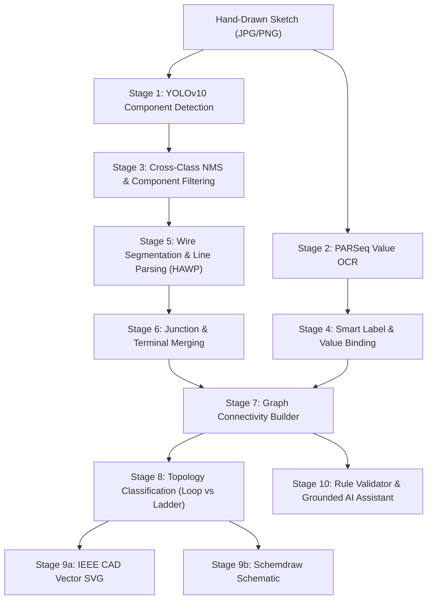

# PaperToCAD: Hand-Drawn Electronic Circuit to CAD Schematic AI Engine

PaperToCAD is an end-to-end Computer Vision and Deep Learning system that transforms hand-drawn analog and digital circuit sketches.

This project generates only two outputs:

1. Identified Components Diagram
2. CAD Schematic Diagram

---

## ⚡ Key Features

- **Component & Text Detection**: YOLOv10 object detection with cross-class Non-Maximum Suppression (NMS) to eliminate duplicate/phantom detections.
- **Optical Character Recognition (OCR)**: Integrated PARSeq model for reading resistor, capacitor, inductor values, and voltage/current ratings.
- **Smart Designation & Value Binding**: Automatically pairs designator labels (`R1`, `V1`, `LED1`) with electrical ratings (`220Ω`, `5V`, `10k`, `100mH`).
- **Topology-Aware Circuit Reconstruction**:
  - Uses detected component terminals and wire-net membership to connect components.
  - CAD renders only inferred nets; it does not add assumed series connections or ground rails.
- **Standardized Vector CAD Schematics**: Exports IEEE electronic schematics in Dark CAD, Light Blueprint, and Schemdraw textbook formats.
- **Interactive Web Studio**: Uploads run the full component, OCR, wire, and connectivity pipeline. Users can inspect component crops, edit values in-place, and re-synthesize schematics on the fly.
- **Circuit Rule Validator**: Real-time sanity checker alerting on floating terminals, direct short-circuits, and missing ground references.
- **Grounded Circuit Assistant**: 
  - **Deterministic / Offline**: Answers queries directly from detected components, topology connections, validation findings, and calculates passive ratings (Ohm's law, RC time constants, LED ballast resistance).
  - **Optional LLM Integration**: Connects to Groq (`GROQ_API_KEY`), OpenAI (`OPENAI_API_KEY`), or local OpenAI-compatible endpoints (`LLM_BASE_URL` with Ollama / vLLM / LM Studio) for conversational circuit explanations.
- **Official Model Context Protocol (MCP) Server**: Exposes complete circuit processing, inspection, validation, and query tools to AI agents and IDEs like VS Code.

---

## 💻 System Prerequisites

- **Operating System**: Windows 10/11, Ubuntu 20.04+, or macOS
- **Python**: Version `3.10`, `3.11`, or `3.12` (Python 3.10+ required for MCP server)
- **Compute Backend**:
  - **CPU**: Fully supported out-of-the-box (no GPU required)
  - **GPU (CUDA)**: Optional NVIDIA GPU with CUDA 11.8+ or 12.1+ for accelerated inference

---

## 📦 Installation Guide

### Option 1: Quick Install using Pip & Virtualenv (Recommended)

1. **Clone or navigate to the repository**:
   ```bash
   cd PaperToCAD_LLM_CV
   ```

2. **Create a virtual environment**:
   - **On Windows (PowerShell)**:
     ```powershell
     python -m venv venv
     .\venv\Scripts\Activate.ps1
     ```
   - **On Linux / macOS**:
     ```bash
     python3 -m venv venv
     source venv/bin/activate
     ```

3. **Install the dependencies**:
   ```bash
   pip install --upgrade pip
   pip install -r requirements.txt
   ```

### Option 2: Install using Conda

```bash
conda env create -f environment.yml
conda activate papertocad
```

### 3. Download Model Weights

Ensure model weights exist in the `weights/` directory:
- `weights/yolo/best.pt` (YOLOv10 circuit object detector)
- `weights/parseq/best_parseq.pt` (PARSeq optical character recognizer)

You can download weights using the multi-threaded downloader:
```bash
python scripts/fast_download.py
```
*(Or alternatively, `python scripts/download_weights.py`.)*

---

## ⚙️ Environment Configuration (.env)

The AI Circuit Assistant runs completely offline using its built-in topological calculation engine. To enable optional LLM-augmented natural language explanations:

1. Copy the example configuration:
   ```bash
   cp .env.example .env
   ```
   *(Or on Windows PowerShell: `Copy-Item .env.example .env`)*

2. Open `.env` and set your preferred provider:
   - **Groq Cloud (Fast & Free tier)**:
     ```ini
     GROQ_API_KEY=gsk_...
     # GROQ_MODEL=qwen/qwen3.8-27b
     ```
   - **OpenAI**:
     ```ini
     OPENAI_API_KEY=sk-...
     # OPENAI_MODEL=gpt-4o-mini
     ```
   - **Local / Self-Hosted (Ollama / vLLM)**:
     ```ini
     LLM_BASE_URL=http://localhost:11434/v1
     LLM_MODEL=llama3.2
     ```

---

## 🚀 Execution Modes

### Method 1: Interactive Web Studio (GUI - Recommended)

Launch the complete Web Studio application with a single command:

```bash
python main.py
```

*Or on Windows, simply double-click **`start.bat`**.*

This automatically boots the FastAPI backend on `http://localhost:8000` and opens your default browser.

#### Studio Capabilities:
- **Interactive View Modes**:
  - **CAD Schematic**: IEEE-standardized orthogonal CAD vector drawing with Dark CAD and Light Blueprint themes.
  - **Schemdraw**: Textbook-grade electronic schematic diagram.
  - **Detection Boxes**: Color-coded YOLOv10 component bounding boxes with confidence scores.
  - **Hand Drawing**: High-resolution view of original sketch.
- **Component Inventory**: Inspect cropped component images, verify ratings, and edit values/designators with instant schematic regeneration.
- **Rule Validator**: Real-time diagnostics for floating pins, short circuits, and ground rails.
- **JSON Export**: One-click download or copy of structured JSON graphs.
- **AI Circuit Assistant**: Live chat sidebar to ask questions, verify connections, or compute passive component values.

#### Advanced CLI Flags:
```bash
python main.py --port 8080      # Run on custom port
python main.py --no-browser     # Run in headless/server mode
python main.py --mcp            # Start Model Context Protocol (MCP) server
```

---

### Method 2: Model Context Protocol (MCP) Server

PaperToCAD includes a built-in MCP server that allows AI assistants (Claude Desktop, VS Code Copilot, Cursor) to directly invoke circuit tools.

#### Starting via CLI:
```bash
python main.py --mcp
```

#### Connecting in VS Code:
The repository includes a ready-to-use configuration in [`.vscode/mcp.json`](.vscode/mcp.json). Open this repository in VS Code and start the `papertocad` server from the MCP Servers tab.

#### Exposed Tools:
| Tool | Description |
| :--- | :--- |
| `process_sketch` | Runs the full 9-stage CV pipeline on a local image path end-to-end. |
| `inspect_circuit` | Returns topological nodes, components, and terminal connections. |
| `validate_circuit` | Evaluates circuit safety rules (shorts, floating terminals, ground reference). |
| `generate_schematic` | Renders IEEE CAD vector SVG and Schemdraw diagrams. |
| `explain_circuit` | Queries the AI Circuit Assistant for grounded technical explanations. |

---

### Method 3: Command-Line Pipeline (CLI Batch Mode)

To process circuits in batch mode using the full 9-stage CV pipeline:

```bash
python scripts/run_pipeline.py
```

Outputs are automatically generated under `outputs/run1/`:
- `outputs/run1/yolo_detect/`: Raw component detections
- `outputs/run1/ocr_parseq/`: Component value bindings
- `outputs/run1/final_result/json/`: Topological circuit connectivity graphs

---

### Method 4: Automated Test Suite

PaperToCAD comes with a comprehensive test suite covering the entire pipeline:

```bash
# Run all 64 unit and integration tests across the project
python -m unittest discover -s tests

# Or run the Master Suite directly
python tests/test_paper2cad_master_suite.py
```

#### Individual Test Suites:
```bash
# Circuit safety and topology rule validation
python tests/test_circuit_validator.py

# Grounded AI Assistant and component value calculations
python tests/test_ai_assistant.py

# Graph-based CAD schematic rendering
python tests/test_cad_graph_rendering.py

# Port alignment and wire tracing
python tests/test_build_connections.py

# Circuit data models and serialization
python tests/test_circuit_data_model.py

# MCP server endpoints and tools
python tests/test_mcp_server.py

# Web Studio server routes and endpoints
python tests/test_ui_server.py

# Circuit topology classification (single-loop vs ladder)
python tests/test_classify.py
```

---

## 📁 Repository Organization

```text
PaperToCAD_LLM_CV/
├── .vscode/
│   └── mcp.json                 # VS Code Model Context Protocol server configuration
├── assets/                      # Character sets, metadata, and typography
│   └── meta/                    # parseq_charset.txt and category metadata
├── configs/                     # YAML configuration files (paths, pipelines)
├── data/                        # Circuit datasets
│   ├── inputs/                  # Sample hand-drawn circuit sketches (cir1–cir5)
│   └── ground_truth/            # Annotated circuit ground-truth JSON files
├── outputs/                     # Output artifacts (auto-generated, gitignored)
│   ├── run1/                    # Pipeline stage execution artifacts
│   ├── ui_jobs/                 # Web Studio uploaded jobs and crops
│   ├── mcp_jobs/                # MCP execution artifacts
│   └── test_previews/           # Preview schematic renders
├── scripts/                     # Pipeline execution and helper scripts
│   ├── run_pipeline.py          # End-to-end 9-stage batch runner
│   ├── download_weights.py      # Standard model weights downloader
│   ├── fast_download.py         # Multi-threaded Hugging Face weights downloader
│   └── run_all.sh               # Shell batch execution script
├── src/                         # Core Python modules
│   ├── mcp_server.py            # Model Context Protocol (MCP) server implementation
│   └── pipeline/                # 9-stage CV & synthesis pipeline
│       ├── ai_assistant.py             # Grounded AI Circuit Assistant & calculation engine
│       ├── circuit_data_model.py       # Pydantic circuit graph, node, and component models
│       ├── circuit_validator.py        # Electrical rule checker (floating pins, shorts)
│       ├── cad_schematic_renderer.py   # Vector CAD (SVG) & Schemdraw engine
│       ├── build_connections.py        # Wire trace & terminal connectivity
│       ├── build_final_json.py         # Graph JSON builder
│       ├── connectivity_inspector.py   # Topological graph query inspector
│       ├── fuse_yolo_parseq.py         # OCR & component binding
│       ├── merge_points.py             # Junction & crossover fusion
│       ├── remove_components.py        # Line inpainting / segmentation
│       └── refine_component_types.py   # Subtype classifier (DINOv2)
├── tests/                       # Dedicated test suite
│   ├── test_paper2cad_master_suite.py  # Master test suite
│   ├── test_ai_assistant.py            # AI assistant and calculation tests
│   ├── test_build_connections.py       # Wire connectivity and port tests
│   ├── test_cad_graph_rendering.py     # Graph-based schematic rendering tests
│   ├── test_circuit_data_model.py      # Circuit data model verification
│   ├── test_circuit_validator.py       # Rule validator tests
│   ├── test_mcp_server.py              # MCP server unit tests
│   ├── test_ui_server.py               # Web Studio server API tests
│   └── test_classify.py               # Topology classification tests
├── third_party/                 # External framework submodules
│   ├── HAWP/                    # Holistic Attraction Wireline Parser
│   ├── parseq-main/             # Permuted Autoregressive Sequence OCR
│   └── mmpose/                  # Keypoint terminal detector
├── ui/                          # Web Studio Application
│   ├── server.py                # FastAPI backend server
│   └── static/                  # Modern responsive web application (HTML/CSS/JS)
├── weights/                     # Model checkpoints (YOLO, PARSeq, ViTPose)
├── main.py                      # Unified single entry point (Web Studio / MCP)
├── run_ui.py                    # Legacy launcher forwarder to main.py
├── start.bat                    # One-click Windows desktop launcher
├── README.md                    # Project documentation & guide
├── requirements.txt             # Pip package requirements
├── environment.yml              # Conda environment configuration
└── .env.example                 # Example environment variables template
```

---

## 📊 Pipeline Stages



---

## ❓ Troubleshooting & FAQs

### 1. Port 8000 is already in use
If another application is using port `8000`, specify a custom port:
```bash
python main.py --port 8080
```
Then visit `http://localhost:8080`.

### 2. First-time model inference delay
On the first request after server startup, PyTorch loads YOLOv10 and PARSeq model weights into memory. This initial initialization takes 5–10 seconds on CPU. Subsequent inference requests execute rapidly in 1–3 seconds.

### 3. Missing weights error
If you receive a missing weights warning, run the fast multi-threaded downloader:
```bash
python scripts/fast_download.py
```

### 4. Windows Terminal Character Encoding
If running on Windows PowerShell / CMD and printing Greek characters (e.g. `Ω`), scripts automatically configure UTF-8 output (`sys.stdout.reconfigure(encoding='utf-8')`).

---

## 📜 License

MIT License. See [LICENSE](LICENSE) for details.
