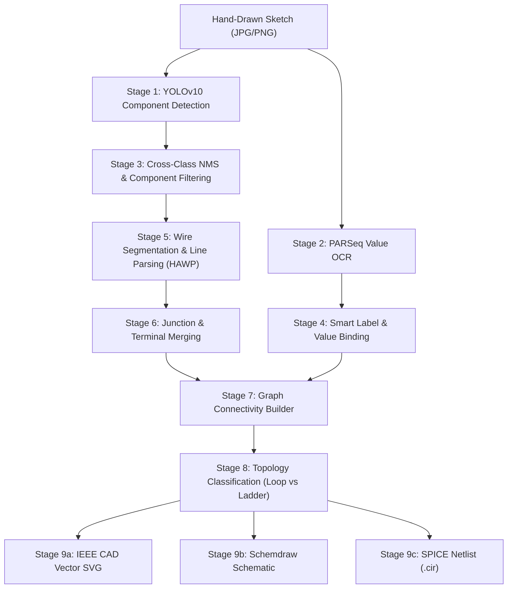

# PaperToCAD: Hand-Drawn Electronic Circuit to CAD Schematic & SPICE Netlist AI Engine

PaperToCAD is an end-to-end Computer Vision and Deep Learning system that transforms hand-drawn analog and digital circuit sketches into standardized, production-ready IEEE electronic CAD schematics (SVG/PNG) and SPICE simulation netlists (`.cir` / `.spice`).

---

## ⚡ Key Features

- **Component & Text Detection**: YOLOv10 object detection with cross-class Non-Maximum Suppression (NMS) to eliminate duplicate/phantom detections.
- **Optical Character Recognition (OCR)**: Integrated PARSeq model for reading resistor, capacitor, inductor values, and voltage/current specifications.
- **Smart Designation & Value Binding**: Automatically pairs designator labels (`R1`, `V1`, `LED1`) with electrical ratings (`220Ω`, `5V`, `10k`, `100mH`).
- **Topology-Aware Circuit Reconstruction**:
  - **Single-Loop Circuits**: Source on left rail $\rightarrow$ series passives on top rail $\rightarrow$ return rail with ground reference.
  - **Multi-Branch Parallel Ladders**: Aligns RLC branches across common left and right bus rails with junction dots (`●`).
- **Standardized Vector CAD Schematics**: Exports IEEE electronic schematics in Dark CAD, Light Blueprint, and Schemdraw textbook formats.
- **SPICE Netlist Synthesis**: Produces standard SPICE simulation decks with model directives (`.MODEL DLED_AUTO`, `.MODEL D1N4148`, `.TRAN`, `.OP`).
- **Interactive Web Studio**: Real-time web interface for dragging & dropping sketches, viewing component bounding boxes, inspecting crop images, and downloading netlists.

---

## 📁 Repository Organization

```text
PaperToCAD_LLM_CV/
├── assets/                  # Typography, fonts, and charset definitions
│   └── meta/                # parseq_charset.txt and category metadata
├── configs/                 # YAML configuration files (paths, pipelines)
├── data/                    # Circuit datasets
│   ├── inputs/              # Sample hand-drawn circuit sketches (cir1–cir5)
│   └── ground_truth/        # Annotated circuit ground-truth JSON files
├── outputs/                 # Output artifacts (auto-generated, gitignored)
│   ├── run1/                # Pipeline stage execution artifacts
│   ├── ui_jobs/             # Web Studio uploaded jobs and crops
│   └── test_previews/       # Verification and preview schematic renders
├── scripts/                 # Pipeline execution scripts
│   ├── run_pipeline.py      # End-to-end 9-stage pipeline runner
│   ├── download_weights.py  # Model weights downloader
│   └── run_all.sh           # Shell batch execution script
├── src/                     # Core Python modules
│   └── pipeline/            # 9-stage CV pipeline components
│       ├── cad_schematic_renderer.py   # Vector CAD & Schemdraw engine
│       ├── build_spice_netlists.py     # SPICE deck synthesizer
│       ├── build_connections.py        # Wire trace & terminal connectivity
│       ├── build_final_json.py         # Graph JSON builder
│       ├── merge_points.py             # Junction & crossover fusion
│       ├── remove_components.py        # Line inpainting / segmentation
│       ├── refine_component_types.py   # Subtype classifier (DINOv2)
│       └── fuse_yolo_parseq.py         # OCR & component binding
├── tests/                   # Test suite & verification scripts
│   ├── test_classify.py            # Topology classification tests
│   ├── test_fix_hallucination.py   # Deduplication & label binding tests
│   ├── test_spice_synthesis.py     # SPICE netlist synthesis tests
│   ├── test_render_cir1_v2.py      # Multi-branch Schemdraw test
│   └── test_render_led.py          # Single-loop Schemdraw test
├── third_party/             # External framework submodules
│   ├── HAWP/                # Holistic Attraction Wireline Parser
│   ├── parseq-main/         # Permuted Autoregressive Sequence OCR
│   └── mmpose/              # Keypoint terminal detector
├── ui/                      # Web Studio Application
│   ├── server.py            # FastAPI backend server
│   └── static/              # Modern dark-mode web application (HTML/CSS/JS)
├── weights/                 # Model checkpoints (YOLO, PARSeq, ViTPose)
├── run_ui.py                # Web Studio launcher entry point
├── environment.yml          # Conda environment configuration
└── requirements.txt         # Pip package requirements
```

---

## 🚀 Quick Start

### 1. Environment Setup

Using Conda:
```bash
conda env create -f environment.yml
conda activate papertocad
```

Or using Pip:
```bash
pip install -r requirements.txt
```

### 2. Launch the Web Studio

To start the interactive web application:
```bash
python run_ui.py
```
Open **[http://localhost:8000](http://localhost:8000)** in your browser.

- Upload any hand-drawn circuit sketch or choose one of the preloaded sample circuits (`cir1` to `cir5`).
- Click **"Convert to SPICE Netlist"** to run inference.
- Switch between **Computerized CAD Schematic**, **Schemdraw**, **Detection Boxes**, and **Original Drawing**.
- View and copy the synthesized SPICE netlist or JSON circuit graph directly from the studio.

### 3. Run Pipeline via CLI

Run the full 9-stage PaperToCAD pipeline:
```bash
python scripts/run_pipeline.py
```

### 4. Run the Test Suite

Run unit and verification tests:
```bash
python tests/test_classify.py
python tests/test_spice_synthesis.py
python tests/test_render_led.py
```

---

## 📊 Pipeline Stages



---

## 📜 License

MIT License. See [LICENSE](LICENSE) for details.
